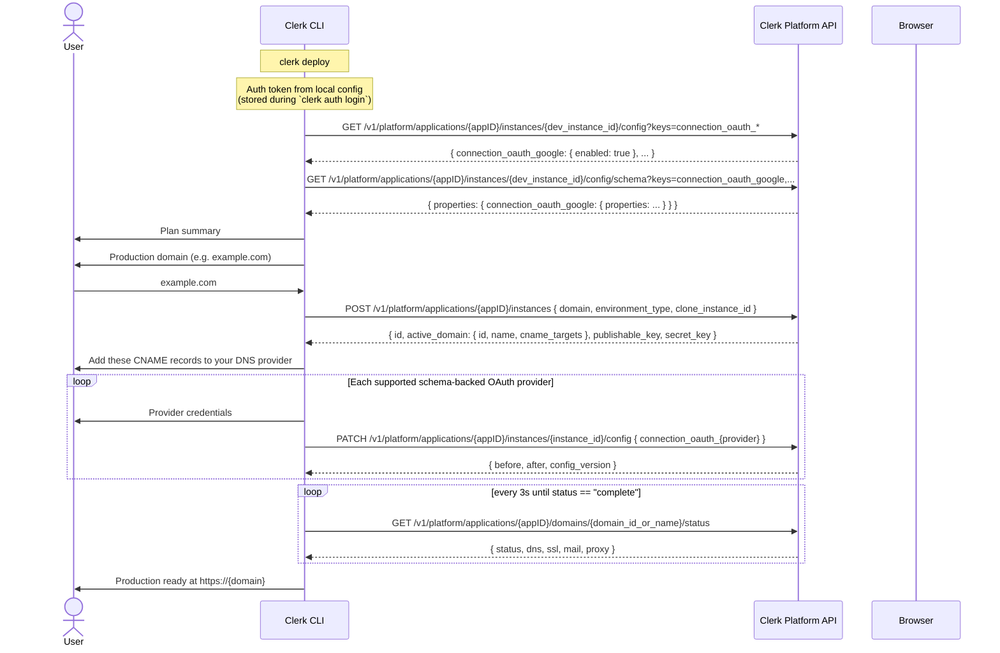

# Deploy Command

> **Live PLAPI lifecycle.** Human mode resolves the linked application, production domains, domain status, and instance config from the Platform API on each run. The production-instance lifecycle calls (`instances` and domain `status`) call the helpers in `lib/plapi.ts` directly. PLAPI error codes are translated to typed `CliError`s by `commands/deploy/errors.ts`.

Guides a user through deploying their Clerk application to production.

When the CLI reaches the DNS configuration step, it displays the required CNAME records and then prompts the user to export those records as a BIND zone file (`./clerk-<domain>.zone`). The prompt defaults to "no" and the file is overwritten silently on subsequent runs. On new deploys, this handoff happens before OAuth setup so DNS propagation can start while the user configures providers.

After all OAuth providers are configured, DNS verification checks DNS, SSL, and email DNS from the same domain status response. The wizard uses one shared exponential-backoff loop instead of waiting for each component separately. If polling times out, the retry handoff lists only DNS records tied to still-pending DNS-backed checks. For example, when DNS and email DNS are verified but SSL is still pending, the CLI shows green checks for the verified components and does not reprint already verified records.

## Usage

```sh
clerk deploy              # Interactive, idempotent wizard (human mode)
clerk deploy --verbose    # With debug output
clerk deploy --domain example.com --yes # Wizard without the domain prompt and confirmations
clerk deploy --mode agent # Emit a read-only handoff for agents
clerk deploy --domain example.com --mode agent # Create or resume production, then emit the handoff
clerk deploy status        # Verify deploy completion without prompts
clerk deploy status --mode agent --wait # Agent verification with retrying wait
```

## Options

| Flag                | Purpose                                                                                                                         |
| ------------------- | ------------------------------------------------------------------------------------------------------------------------------- |
| `--domain <domain>` | Production domain. Skips the domain prompt; in agent mode it is what allows creating the production instance.                   |
| `--yes`             | Skips the wizard's "Proceed?" and "Create production instance?" confirmations, and nothing after them. No effect in agent mode. |

`--domain` is validated like the prompt (a domain whose DNS records you can add, no scheme, no hosting providers' domains) and only applies when the instance is created. The comparison ignores case and a trailing dot, and only a run that found an existing instance makes it: an application has one production instance, so a run whose own create succeeded is on the requested domain however Clerk spells it back. If the application already has a production instance on another domain, the command fails with `production_instance_exists` instead of reporting on a domain that was not asked for. In the wizard, a domain typed at the prompt is checked the same way when the create finds an instance another run made, and the messages name it as the domain you entered rather than as `--domain`. While Clerk has not yet returned the existing instance's domain (`domain_provisioning`), there is nothing to compare `--domain` against, so a run that did not create the instance fails with `deploy_domain_unchecked` instead, in agent mode and in the wizard alike, even when the domain is the one it was created with. The two codes call for different next steps: `production_instance_exists` means the instance is on another domain, so ask the user; `deploy_domain_unchecked` means wait, since `clerk deploy status` shows the domain once Clerk returns it. Both flags are refused on `clerk deploy status`.

## Global Options

| Flag        | Purpose                                      |
| ----------- | -------------------------------------------- |
| `--verbose` | Show detailed deploy and PLAPI debug output. |

## Agent Mode

When running `clerk deploy` in agent mode (`--mode agent`, `CLERK_MODE=agent`, a recognized agent run, or non-TTY context), the command emits a structured JSON handoff via `log.data` on stdout. Without `--domain` the handoff is read-only: it resolves the linked app, production instance, domain, domain status snapshot, and OAuth completeness, but it does not prompt, mutate config, trigger a DNS check, or poll.

With `--domain`, agent mode first creates the production instance (cloning development) when the application has none, saves its id to the local profile, and then emits the same handoff. It never prompts and never writes OAuth credentials. The application's instance list can trail a create, so while it doesn't show the instance the command uses the id the create returned (or an earlier read found), and whichever read finds the instance, its id is saved to the profile. If Clerk's list lags right after a create, `clerk deploy status` can still say `not_started`; rerunning `clerk deploy --domain` with the same domain then resumes the instance, fails with `deploy_instance_unresolved` until Clerk lists it, or, if Clerk lists the instance before its domain, fails with `deploy_domain_unchecked` until the domain shows. If the read after the create fails, or Clerk says an instance exists but returns none, the command fails saying the instance exists and to run `clerk deploy status`, rather than failing as if nothing had been created. A 404 on the production domain's status fails with `deploy_instance_unresolved`, saying the instance was created (or exists, when this run found it) and its status couldn't be read yet. When this run found the instance rather than creating it, the message adds that if the instance was deleted, `clerk deploy status` reports `not_started` once Clerk stops listing it, and to run `clerk deploy --domain` then. Other API failures on that read keep Clerk's own error code, with the same pointer to `clerk deploy status` in the message. The rest of the deploy is driven from the report:

1. Add the records in `pendingDnsRecords` at the DNS provider.
2. For each `oauth.setup` entry without a `fileContents` field, create a file outside the project with `mktemp` (readable only by your user), write its `payload` (placeholders included) into it with a shell command (`printf '%s' '<payload>' > <path>`), have the user replace the placeholders with the real values, then run its `command` (`clerk config patch --instance <id> --file <file> --yes`) on that file without reading it, inside `( rc=0; <command> || rc=$?; rm -f "<path>"; exit "$rc" )` so the file is removed whether or not the command succeeds and a failed save still fails. `clerk config patch` refuses a payload that still holds a placeholder, naming the field, and `clerk deploy status` doesn't count a placeholder as a saved credential. An entry with a `fileContents` field (Apple's private key) never goes through such a file: save the other entries first, if any, then send the user to `clerk deploy` in a terminal for it, since the wizard reads the key from its file. The entries are present while the domain is still pending, so this can overlap with DNS propagation.
3. If `nativeAppleReadinessIssue` is present (an iOS app using native-only Sign in with Apple), follow the guidance in `nextAction`: depending on `reason`, set the production Apple connection's Bundle ID, register the iOS app or enable Native API at `dashboardUrl`, or retry later. Apple has no `oauth.setup` entry in that case.
4. Gate on `clerk deploy status --wait`.
5. Pipe the keys to the host's CLI with `clerk env pull --instance <id> --print`, without reading the output: it holds the secret key. For Vercel, run the `command` of the report's `hostSetup` entry, copied verbatim.

The report's commands name the production instance by id rather than `prod`: that alias reads the local profile, which has no production instance when it was created in the Dashboard or on another machine.

A plan that does not cover development's features fails the create with `plan_insufficient` and creates nothing.

The handoff state is one of:

| State                 | Meaning                                                                                                                                                    |
| --------------------- | ---------------------------------------------------------------------------------------------------------------------------------------------------------- |
| `not_started`         | Clerk lists no production instance. Ask the user for their domain, then `clerk deploy --domain`; right after one succeeded, rerun it with the same domain. |
| `domain_provisioning` | A production instance exists, but PLAPI has not returned a production domain yet.                                                                          |
| `domain_pending`      | A production domain exists, but DNS, SSL, email DNS, or final server-side readiness is pending.                                                            |
| `oauth_pending`       | The domain is verified, but supported OAuth providers still need production credentials.                                                                   |
| `complete`            | Production is deployed and verified.                                                                                                                       |

Agent-mode `clerk deploy` without `--domain` is informational and exits 0 for linked projects. With `--domain` it exits 0 once the instance is created or resumed and the report is printed, and non-zero when it refuses the domain (`production_instance_exists`, `deploy_domain_unchecked`), when Clerk refuses the create, or when the instance's status can't be read afterwards (`deploy_instance_unresolved`, or Clerk's own code). Either way, the pass/fail gate for the deploy itself is `clerk deploy status`.

### `clerk deploy status`

`clerk deploy status` is the read-only verification command for agents and automation. It resolves the same live deploy state, triggers a DNS check for active production domains, and reports DNS, SSL, email DNS, and OAuth completeness. Human mode waits with the shared exponential-backoff poll loop; agent mode performs one quick DNS check and returns the resulting status immediately by default. Pass `--wait` in agent mode to wait with the same poll loop: one immediate status read, then up to 5 retries with exponential backoff.

In agent mode, `clerk deploy status` emits JSON on stdout with:

- `complete`: `true` only when the domain is verified and all supported OAuth providers enabled in development have production credentials.
- `state`: `complete`, `domain_pending`, `oauth_pending`, `domain_provisioning`, `not_started`, or `interrupted`.
- `domainStatus`: per-component DNS, SSL, and email DNS status when a domain exists.
- `pendingDnsRecords`: CNAME records still tied to pending DNS-backed checks, each with `host`, `value`, and Clerk's `required` flag (some targets are optional).
- `oauth`: configured, pending, and unsupported provider slugs, plus `setup`: one entry per pending provider (except Apple while `nativeAppleReadinessIssue` is present, since native-only Apple needs that fix rather than web credentials) with its `configKey`, credential `fields` (`required`, `secret`, `options`, and `fileContents` when the value is a file's contents, such as Apple's `.p8` key), the `redirectUri` and `authorizedOrigins` the provider's OAuth app must allow, `docsUrl`, a `note`, and the `payload` template (required fields only) and `command` that save the credentials.
- `nativeAppleReadinessIssue`: present only when Apple is native-only (a `bundle_id` and no hosted credentials) and not yet ready in production. Development's native-only connection counts when production Apple has neither a Bundle ID nor hosted credentials, as creating production leaves it. Holds the `bundleId`, a `reason` (`bundle-id-missing`, `authentication-disabled`, `registration-missing`, `registration-ambiguous`, `registration-bundle-case-mismatch`, `native-api-disabled`, or `verification-unavailable`), and the production Native Applications `dashboardUrl`. `nextAction` includes the matching guidance.
- `appleProject`: present (as `true`) only when the command runs in an iOS or macOS app's directory (the same detection `clerk doctor` uses for its Xcode checks). Deploy can't see the Xcode project, so at `complete` `nextAction` adds a pointer to `clerk doctor`, which checks that Release uses the production publishable key, Associated Domain, and native registration. The wizard's next steps add the same step there.
- `urls`: the production instance's Dashboard page (`instance`) and its Domains page (`domains`), or `null` before a production instance exists. The same URLs appear in `nextAction` prose; this field is the one to read programmatically.
- `hostSetup`: commands that put the production keys on a host without the agent reading them. At `complete` it has one entry per host the CLI has a recipe for (today Vercel), each with `host` (`vercel`), `label`, `shells` (`bash`, `zsh`), and `command`, to copy verbatim; in every other state it is `[]`. The command names the production instance by id. On macOS and Linux, every `hostSetup` and `oauth.setup` command starts with `clerk` only when the `clerk` found on PATH, not counting `node_modules/.bin` folders, resolves to the running binary itself (for a source run, the running script), and otherwise with the running CLI's single-quoted absolute path (for a source run, the quoted `bun` and script paths), so it runs as given when the CLI was started through `npx`. On Windows these commands keep `clerk`.
- `nextAction`: the next step an agent should present to the user. While domain setup remains (`domain_provisioning` and `domain_pending`) it includes the Clerk Dashboard domains URL, and agents should ask whether to open that URL for the user; `not_started` and `interrupted` carry no URL, `oauth_pending` carries no Domains URL (native Apple guidance may link to the Native Applications page), and `complete` carries the instance root instead. While DNS or email DNS records are unverified it says to add the records in `pendingDnsRecords` at the domain's DNS provider rather than to keep polling; if that list is empty (the API returned no CNAME targets) it says so and points at the Dashboard Domains page instead; when only SSL is pending it says to wait. At `not_started` it says to ask the user for a domain they own and run `clerk deploy --domain <domain>`, and, if `clerk deploy --domain` just succeeded, to rerun it with the same domain instead of asking for a new one. Human mode says the same about rerunning the wizard. At `oauth_pending` it says to create a file for each `oauth.setup` entry without a `fileContents` field outside the project with `mktemp` (readable only by the user), write the entry's `payload` into it with its placeholders, have the user replace them with the real values, run its `command` on the file without reading it, and remove the file whether or not the command succeeds, in a wrapper that keeps the command's exit status (so secrets stay out of the agent's transcript, off the command line, and out of the repository), or to have the user run the wizard. For an entry with a `fileContents` field (Apple's private key), it says to save the other `oauth.setup` entries first, if any, then send the user to the wizard for it; when that is the only entry, it leaves out the file steps and the wizard alternative. When `nativeAppleReadinessIssue` is present it gives that guidance instead and points any other pending providers at `oauth.setup`, without the wizard alternative (the wizard would ask for Apple web credentials first). At `complete` it says the production keys still have to reach the host (`clerk env pull --instance <id> --print`, which unlike a bare `env pull` does not write them over the local development keys, alongside the other Clerk variables in the env file), piped to the host's CLI without the agent reading them. For Vercel it points at the `hostSetup` entry whose `host` is `vercel` rather than quoting the command: a bash or zsh command that reads the keys into a variable first and lists the project's variables (`vercel env ls`, with color and links off) before changing anything. It ends the same way under a caller's `set -e` as without it, and its first statement is `set +x`, so a caller's `set -x` can't trace a key to stderr. If `vercel env ls` itself fails (Vercel not installed, not logged in, or the project not linked), it prints Vercel's error to stderr and stops with exit 1, so the agent can tell the user to run `vercel login` or `vercel link`. If that output still holds an escape code once color codes are stripped, or is neither Vercel's table nor its "No Environment Variables found" line, it stops with exit 1. If a key is already set as a production variable that also targets another environment (Preview, Development, or a custom one), it stops with exit 3 and the agent asks the user before replacing it, because whether `--force` on production rewrites such a shared variable, putting the production secret key in those deployments, is unverified. Consent is part of the command: it sets `allow_shared=0` right after `set +x`, and the agent reruns it with `allow_shared=1` for that one run once the user agrees. Otherwise it replaces the production values with `vercel env add --force`, exits non-zero if the pull or any upload fails, and says to redeploy only after it exits 0. For a host without a CLI it says to have the user run the `env pull --instance <id> --print` command, starting the same way as the `hostSetup` command, in a separate terminal, not through the agent's session (a shell escape such as Claude Code's `!` would put the keys in the transcript), with `| pbcopy` on macOS to copy the lines without showing them, and add the lines. For every host it then says to redeploy and sign up on the domain to confirm — "complete" is Clerk's side only — and links the instance root (users, settings, billing) instead of the domains page, since nothing is left to monitor there. At `complete` and `oauth_pending` it also names any providers in `oauth.unsupported`, since `oauth.complete` covers only what the CLI manages and those providers' sign-in fails in production until configured in the Dashboard. Human mode prints its own sentence, rendered from the same classification of the report (`deployNextStep` in `status.ts`) rather than by rewriting the agent's: no unsupported-provider clause (the warning row above already says it), no "ask the user" (the reader is the user), no `--wait` (human mode always waits; the wizard is what resumes setup), and, when records are pending, the records themselves printed first so the sentence only says what happens once they are added. At `complete` it has the person run `clerk env pull --instance <id> --print` and add the printed lines to the host, since a bare `env pull` writes the production keys over the development ones in the local env file. Before a production instance exists, human mode omits the OAuth row rather than printing "pending: none" for something that was never checked.

Exit codes:

| Exit | Meaning                                                                                       |
| ---- | --------------------------------------------------------------------------------------------- |
| `0`  | Deploy is complete and verified.                                                              |
| `1`  | The check ran successfully, but deploy is incomplete. Inspect `state` and `nextAction`.       |
| else | A real CLI error occurred, such as not linked or an API failure, via the standard error path. |

A 404 on the production domain's status or DNS-check request fails with `deploy_instance_unresolved` ("The production instance exists, but Clerk couldn't read its domain status yet"), not `not_linked`: the application was read moments earlier, so the status usually just isn't readable yet. The same 404 also follows a production instance deleted since, so unless the run just created the instance the message adds: "If the production instance was deleted, `clerk deploy status` reports `not_started` once Clerk stops listing it; then run `clerk deploy --domain`." (`clerk link` wouldn't help: with a profile present it changes nothing, and deploy state comes from Clerk's list.) The wizard's DNS polling does the same. Other API failures keep Clerk's own error code.

### A folder with no linked application

`clerk deploy` and `clerk deploy status` stop with `not_linked`, exit 1, in both modes, before any API call. The message starts with "No Clerk project linked to this directory." (agents and the skill's troubleshooting table match on it), says what to run next for what the folder holds, and ends with the rerun: the same command with the flags it had, `--domain` and `--yes` for `clerk deploy` and `--wait` for `clerk deploy status`. An agent creates production only with `--domain`, so a rerun without it would exit 0 with nothing created. In agent mode the JSON error also carries `examples`: the same commands, in order, each with a description. Person mode prints no "Examples:" block, since the message already names them.

The advice comes from `lib/unlinked-folder.ts`, which every command that reports an unlinked folder shares. It reads the folder's files and checks which credential is present (`CLERK_PLATFORM_API_KEY`, or a stored session), with no API call. "Signed in" below means either is present.

| What the folder holds                                                                   | Person                                                                                                             | Agent, signed in                                                                                              | Agent, signed out                                                   |
| --------------------------------------------------------------------------------------- | ------------------------------------------------------------------------------------------------------------------ | ------------------------------------------------------------------------------------------------------------- | ------------------------------------------------------------------- |
| An init token (`.clerk/keyless.json`, from `clerk init` run signed out)                 | `clerk link`: it claims the app and links the folder                                                               | same                                                                                                          | `clerk auth login`: it claims the app and links the folder          |
| Only the keys a Clerk SDK wrote for an app it created (`.clerk/.tmp/keyless.json`)      | `clerk link`: it links the app if it's in the account, or opens its claim page; after claiming, `clerk link` again | a person runs `clerk open` in their own terminal and claims the app where the message says, then `clerk link` | a person's `clerk open`, then `clerk auth login`, then `clerk link` |
| That SDK file, with no publishable key or unreadable                                    | link an existing app with `clerk link --app <app_id>`                                                              | `clerk apps list --json`, then `clerk link --app <app_id>`                                                    | `clerk auth login` first                                            |
| That SDK file, with a publishable key but no usable claim link                          | `clerk link`: it links the app if it's in the account, and otherwise says to link one by ID                        | same                                                                                                          | `clerk auth login`, then `clerk link`                               |
| A publishable key                                                                       | `clerk link`: it finds the app by that key, or says none uses it                                                   | same                                                                                                          | `clerk auth login`, then `clerk link`                               |
| A secret key only                                                                       | `clerk link`, choosing the app from the list                                                                       | `clerk apps list --json`, then `clerk link --app <app_id>`                                                    | `clerk auth login` first                                            |
| Keys the CLI can't tell apart, a Clerk line it can't read, or an env file it can't read | the reason, then `clerk link`, choosing the app                                                                    | the reason, then `clerk apps list --json` and `clerk link --app <app_id>`                                     | `clerk auth login` first                                            |
| No keys                                                                                 | `clerk link` to choose an app, or `clerk init` to create one                                                       | `clerk apps list --json`, then `clerk link --app <app_id>`, or `clerk init` to create one                     | `clerk auth login` first                                            |

No message suggests `deploy --app`: `clerk deploy` has no such option.

### What telemetry records about a deploy run

Telemetry's `outcome` says what happened to the _command_, not to the deploy. A `clerk deploy status` run on a deploy that is not finished records `outcome: "incomplete"` rather than `"error"`: the check ran and answered, and nothing failed. It still exits 1, so `clerk deploy status && ./cutover.sh` stops as before, and it carries no error code, because nothing was thrown. A run that fails for a real reason — not linked, an API error — throws and is recorded as an error with that error's code, unchanged.

`success` does not mean the deploy is finished either. `clerk deploy` under an agent prints a status report and exits 0 even when no production instance exists. How far a deploy got is carried by the `stage` and `components` payload fields, never by `outcome`.

Four ways a run ends with the deploy unfinished and nothing broken. All four exit the way they always have, and the three that exit nonzero are told apart by their error code rather than by `exit_code`, which cannot separate the first from the third since both are 1. An actual failure — an unresolvable production instance, a domain Clerk did not return — is not one of these and carries its own code.

| Ending                                                              | `outcome` | `error_code`        | `pause_step`             | Exit |
| ------------------------------------------------------------------- | --------- | ------------------- | ------------------------ | ---- |
| The user skipped an OAuth provider                                  | `error`   | `deploy_paused`     | the step they stopped on | 1    |
| The user interrupted a prompt after the production instance existed | `abort`   | `deploy_cancelled`  | the step they stopped on | 130  |
| Every DNS component verified, Clerk still provisioning              | `error`   | `deploy_finalizing` | null                     | 1    |
| The user chose "skip" at DNS verification                           | `success` | null                | null                     | 0    |

`pause_step` is null on the finalizing row on purpose: nobody stopped there, the deploy is waiting on Clerk, and recording `dns` would count a drop-off that never happened. The DNS skip is a finished command, not a pause — the wizard prints its summary and exits 0 — so it carries no code, and it is the row to remember when the `paused` class contains no DNS traffic. A Ctrl-C at a prompt _before_ the production instance exists is not any of these either — there is no state to preserve, so it stays a plain `abort` at exit 0 (a Ctrl-C while a request is in flight is the signal handler's, at exit 130).

The interrupted row is `abort`, like a Ctrl-C anywhere else, so the same keypress is not counted as an error when it happens to land on a prompt; `deploy_cancelled` and `pause_step` still say which prompt.

`stage` is the state the deploy was in when the run ended, on every `deploy` and `deploy status` event: the same value the status report's `state` field prints, so a wizard run and a `clerk deploy status` run a second later agree about the same deploy. It is the deploy's state, not the wizard's position. On a fresh deploy the DNS handoff comes before OAuth setup, so someone who skips a provider is at `domain_pending` with `pause_step: "oauth"`; `oauth_pending` there would contradict the status command. One value per run, the last one observed.

It is null when no reliable state was established by the time the run ended, and that null is a different answer from `not_started`. That covers a run that failed before reading anything — not linked, a failed sign-in, an API error on the first read — and two cases where a state was invalidated or never observed: a resume whose domain read failed and substituted an all-pending status so the user could retry from the screen, where the user then skipped verification; and a fresh run whose create call answered that an instance already exists, after which the resume could not read it. Two states are known without a status read: a fresh deploy starts at `not_started`, and a newly created instance is at `domain_pending` the moment Clerk returns it with a domain (`domain_provisioning` if it did not). Every other value comes from a read that succeeded.

`components` says which of the four pieces were verified when the run ended: `dns`, `ssl` and `mail` from the domain-status response, `oauth` from whether every required provider has production credentials — the same facts the status report's `domainStatus` and `oauth.complete` print. Each is `true`, `false` or null, and null means never observed, which is a different answer from `false`: a failed status call is not a DNS failure. The four come from two reads, so they are two observations. A domain poll rewrites the first three and leaves `oauth` as it was; a production-configuration read or a credential save rewrites `oauth` and leaves the other three. Within a group the last observation wins. A read that never happened, or a substituted one, writes nothing, and each read is recorded the moment it succeeds, so a failure in the other read does not discard it. So a resume whose domain read failed sends `oauth` from its configuration read and null for the other three; a `clerk deploy status` whose domain read failed does the same, with a null stage, since no state was established. On a fresh deploy, `oauth` is written only once every required credential is saved (`true`), because until then nothing has read the production configuration — a save proves only the provider it saved. A fresh run that pauses part-way through OAuth setup therefore sends null for `oauth` even though `clerk deploy status` on the same deploy would read the configuration and say `false`; that is the one place the two are allowed to differ, and null rather than an assumed `false` is deliberate. A fresh run that saves every provider's credentials and skips DNS verification sends `oauth: true` with the other three null. `oauth` reflects the CLI's required-provider rule as it stands; when GROW-1236 changes that rule, this value follows, because it is computed from the same report.

What the warehouse depends on, as of data-platform#604, so a change here is checked there too. Its classifier reads `outcome` before anything else, which is why a command may not declare `success` for a nonzero exit. Its payload contract test accepts exactly the five deploy `stage` values on `deploy run` and `deploy status`, which is why a finished deploy is `complete` and never the shared `done`. It alarms on a missing `pause_step` only for `deploy_paused` and `deploy_cancelled`, so a new ending that should carry a step needs adding there. `pause_step` and `components` are top-level payload keys, null on other commands, because the staging model reads those exact paths.

Agent mode is detected via the mode system (`src/mode.ts`), which checks in priority order:

1. `--mode` CLI flag
2. `CLERK_MODE` environment variable
3. The Codex run markers in `CODEX_ENV_VARS` (`lib/env-signals.ts`): Codex attaches a TTY to every command, so it is agent mode regardless of the next check
4. TTY detection (`process.stdout.isTTY`)

The human-mode wizard still starts only in human mode.

## PLAPI Lifecycle

Human mode, and agent mode with `--domain`, read and write deploy state through the Platform API on every run. The CLI does not persist deploy progress locally; the only profile write is the ordinary `instances.production` value once the production instance has been created.

| Step                       | Endpoint                                                                    | Behavior                                                                                                                                                                                                                                                                                                                                                 |
| -------------------------- | --------------------------------------------------------------------------- | -------------------------------------------------------------------------------------------------------------------------------------------------------------------------------------------------------------------------------------------------------------------------------------------------------------------------------------------------------- |
| Create production instance | `POST /v1/platform/applications/{appID}/instances`                          | Returns `id`, `environment_type`, `active_domain`, `publishable_key`, `secret_key` (once), and timestamps. DNS records are read from `active_domain.cname_targets[]`.                                                                                                                                                                                    |
|                            |                                                                             | Performs clone feature compatibility validation before creating production resources. 402 `unsupported_subscription_plan_features` → `ERROR_CODE.PLAN_INSUFFICIENT` listing missing features. 409 `production_instance_exists` → CLI re-derives state via `fetchApplication` and falls through to `reconcileExistingDeploy` (agent mode: to the report). |
| Trigger domain DNS check   | `POST /v1/platform/applications/{appID}/domains/{domainIDOrName}/dns_check` | Starts a server-side DNS check. `clerk deploy status` triggers this before resolving the live state. Agent-mode `clerk deploy status` returns after the post-trigger status snapshot by default; `--wait` polls active production domains with the shared retry loop. A 409 conflict means a check is already running.                                   |
| Poll domain status         | `GET /v1/platform/applications/{appID}/domains/{domainIDOrName}/status`     | Returns aggregate `status` plus nested DNS, SSL, email DNS, and proxy component status. The CLI drives one shared DNS verification loop over the full status response. The aggregate `status` guards proxy and other server-side readiness gates. It performs one immediate status read, then polls every 3s.                                            |
| Save OAuth credentials     | `PATCH /v1/platform/applications/{appID}/instances/{instanceID}/config`     | Returns the updated config snapshot. Used to persist production `connection_oauth_*` credentials.                                                                                                                                                                                                                                                        |

After displaying the DNS records block, when CNAME records are present the CLI prompts "Export DNS records as a BIND zone file? (y/N)". On yes, it writes `./clerk-<domain>.zone` in the current working directory. The file is a standard BIND fragment containing `$ORIGIN`, `$TTL 300`, and one fully-qualified CNAME per record. The default is "no" and the file is overwritten silently on subsequent runs. Most major DNS providers (Cloudflare, Route 53, Google Cloud DNS, and others) support importing BIND zone fragments. The same prompt appears on both new deploys and resumed deploys.

PLAPI errors are translated to typed `CliError`s by `commands/deploy/errors.ts`. The CLI does not auto-retry SSL issuance or email DNS verification beyond the shared DNS verification loop. When domain status polling times out with SSL or email DNS still incomplete, the CLI surfaces the component status and instructs the user to rerun `clerk deploy` once DNS propagates.

If the user presses Ctrl-C after the production instance has been created — at a prompt or during the DNS wait — the wizard tells them to run `clerk deploy` again and exits with SIGINT code 130. The deploy is unfinished either way, so `clerk deploy && ./cutover.sh` stops rather than proceeding against a half-configured instance. The next run derives the current DNS or OAuth step from API state and resumes without starting another production instance.

`clerk deploy status` also exits 130 on Ctrl-C, and always emits a report on the way out. Interrupted mid-wait, it reports what the last completed poll established. Interrupted before the live state resolves — during the preflight DNS check or the state read — it reports `state: "interrupted"`, which asserts nothing about the deploy. See [`.claude/rules/interrupts.md`](../../../../../.claude/rules/interrupts.md).

## Sequence Diagram



## API Endpoints

All endpoints are on the **Platform API** (`/v1/platform/...`) and are live HTTP calls. The deploy command calls the helpers in `lib/plapi.ts` directly.

| Step                        | Method  | Endpoint                                                                           | Helper                                                                                                                                           |
| --------------------------- | ------- | ---------------------------------------------------------------------------------- | ------------------------------------------------------------------------------------------------------------------------------------------------ |
| Auth                        | n/a     | Local config                                                                       | Token stored from `clerk auth login` or `CLERK_PLATFORM_API_KEY`.                                                                                |
| Read instance config        | `GET`   | `/v1/platform/applications/{appID}/instances/{instanceID}/config`                  | `fetchInstanceConfig` from `lib/plapi.ts`. Discovers enabled `connection_oauth_*` providers.                                                     |
| Read instance config schema | `GET`   | `/v1/platform/applications/{appID}/instances/{instanceID}/config/schema`           | `fetchInstanceConfigSchema`. Reads schemas for supported OAuth config keys so deploy can derive credential prompts.                              |
| Patch instance config       | `PATCH` | `/v1/platform/applications/{appID}/instances/{instanceID}/config`                  | `patchInstanceConfig`. Writes production OAuth credentials.                                                                                      |
| Read application            | `GET`   | `/v1/platform/applications/{appID}`                                                | `fetchApplication`. Resolves development and production instance IDs.                                                                            |
| List production domains     | `GET`   | `/v1/platform/applications/{appID}/domains`                                        | `listApplicationDomains`. Recovers production domain name and CNAME targets on each run.                                                         |
| Read native settings        | `GET`   | `/v1/platform/applications/{appID}/instances/{instanceID}/native_settings`         | `getNativeSettings`. Checks Native API for native-only Apple readiness.                                                                          |
| List iOS registrations      | `GET`   | `/v1/platform/applications/{appID}/instances/{instanceID}/native_applications/ios` | `listIOSApplications`. Checks the production registration for a native-only Apple Bundle ID.                                                     |
| Create production instance  | `POST`  | `/v1/platform/applications/{appID}/instances`                                      | `createProductionInstance`. Returns prod instance, primary domain, keys, and DNS records nested under `active_domain.cname_targets[]`.           |
| Trigger domain DNS check    | `POST`  | `/v1/platform/applications/{appID}/domains/{domainIDOrName}/dns_check`             | `triggerApplicationDomainDNSCheck`. Called by the wizard and by `clerk deploy status`; agent mode waits briefly, then reads one status snapshot. |
| Poll domain status          | `GET`   | `/v1/platform/applications/{appID}/domains/{domainIDOrName}/status`                | `getApplicationDomainStatus`. Drives the wizard spinner and the human-mode `clerk deploy status` wait loop over the full domain status response. |

## OAuth Provider Config Format

Config keys follow the pattern `connection_oauth_{provider}`. When writing credentials to a production instance:

```json
PATCH /v1/platform/applications/{appID}/instances/production/config

{
  "connection_oauth_google": {
    "enabled": true,
    "client_id": "123456789-abc.apps.googleusercontent.com",
    "client_secret": "GOCSPX-..."
  }
}
```

### OAuth provider support

`clerk deploy` discovers enabled built-in OAuth providers from development config keys named `connection_oauth_{provider}`. For public built-in providers supported by the deploy flow, the command reads `GET /config/schema` and derives credential prompts from the provider schema.

Most providers ask for `client_id` and `client_secret`. Provider-specific schema fields are prompted when they are safe for deploy setup, such as Linear `actor`.

The CLI keeps small local overrides for provider setup details that schema does not fully describe:

| Provider | Override                                                                                                                                                                   |
| -------- | -------------------------------------------------------------------------------------------------------------------------------------------------------------------------- |
| Google   | Optional Google Cloud Console JSON import, OAuth consent screen warning, and a tip that the consent-screen name is what users see, so choose the name you want them to see |
| Apple    | `.p8` file import, production-required `team_id` and `key_id`, native-only field omissions                                                                                 |

Apple configured with only a `bundle_id` (no `client_id`, `client_secret`, `team_id`, or `key_id`, matching the backend's rule) is native-only. It counts as configured once Apple is enabled for authentication, the Bundle ID has exactly one production iOS registration, and Native API is enabled. Until then the wizard offers to add Apple web credentials; declining prints the fix with a link to the production Native Applications page and pauses the deploy, as skipping any provider does. In agent mode the report carries the same fix in `nativeAppleReadinessIssue` and `nextAction`, and leaves Apple out of `oauth.setup`, whose entries ask for web credentials. Since a Bundle ID alone reads as native-only even when the app also offers Apple sign-in on the web (development serves that with Clerk's shared credentials), `nextAction` adds that web sign-in in production needs Apple web credentials too, which the user can add with `clerk deploy` in a terminal.

For Google, the wizard can load `client_id` and `client_secret` from the top-level `web` object in a Google Cloud Console OAuth client JSON file, or from `installed` for desktop-style client downloads. The file contents are used in memory and are not written to CLI config.

Providers not currently supported by automated deploy setup are cloned to production without automated credential setup. Configure those providers from the Clerk Dashboard before going live.

Production instances return `422` if you try to enable a provider without credentials.

## Helpful values for OAuth walkthrough

When the user chooses the guided walkthrough, these values are derived from their domain:

| Field                         | Value                                      |
| ----------------------------- | ------------------------------------------ |
| Authorized JavaScript origins | `https://{domain}`, `https://www.{domain}` |
| Authorized redirect URI       | `{frontend_api_url}/v1/oauth_callback`     |

The redirect URI is served by the Frontend API (`clerk.{domain}`), not the Account
Portal (`accounts.{domain}`). Use the `frontend_api_url` returned on the domain
object rather than reconstructing it from the domain name.
