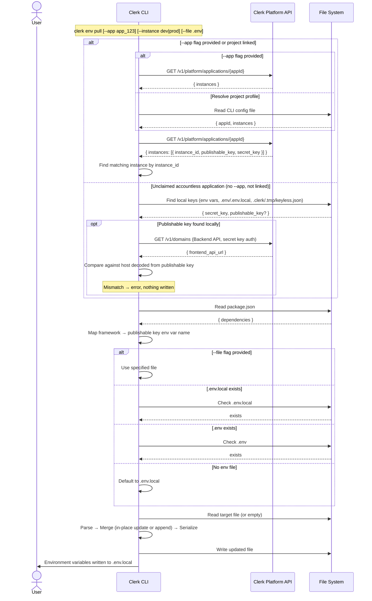

# Env Pull Command

Pulls Clerk API keys for the linked instance and merges them into the project's `.env` file.

`--print` writes `KEY=value` lines to stdout instead of touching any file, for piping into a hosting provider (`clerk env pull --instance prod --print | …`). It always includes the secret key, because nothing lands on disk, and it fails with `no_secret_key` without printing anything when the API returns none: a host given only the publishable key would pair it with the secret key it already has. It cannot be combined with `--file`.

For an unclaimed **accountless** application there is no account to pull from — its keys only exist on this machine. When the directory isn't linked and no `--app` is passed, `env pull` instead copies the keys the folder's app loads, read as `clerk link` reads them (`readFolderKeys` in [`lib/local-keys.ts`](../../lib/local-keys.ts)): an exported variable, then the framework's env files in its documented load order (e.g. `.env.development.local` first for Next.js, only `.env` for Nuxt), or the `.clerk/.tmp/keyless.json` an SDK wrote for itself when the folder holds no plain key, into the env file the framework reads. When files disagree and no load order says which the app loads, it guesses neither: the folder counts as not linked, and the error says why. This is what materializes an SDK-created accountless app into `.env.local`. The line it prints after writing says "Accountless application keys" for an app in no account yet (an init app, or an SDK app whose claim link works), and "This folder's application keys" otherwise, e.g. for plain keys, which may belong to an app already in an account. If only the secret key can be found, it's written and a warning names the missing publishable key, then gives the step for what the folder held before the write (from `lib/unlinked-folder.ts`) and says to run `clerk env pull` again.

The secret key and publishable key are each the one the app loads, but can still belong to _different_ applications (e.g. leftovers from two apps in the same `.env.local`). Before writing, `env pull` calls `GET /v1/domains` with the secret key and confirms the publishable key's Frontend API host (decoded via `decodePublishableKey` in `lib/fapi.ts`) matches one of that instance's own domains. A mismatch aborts the pull with an error that says where the mismatched publishable key was found and how to remove it from there (its env file or the shell variable; for a stale `.clerk/.tmp/keyless.json`, it first suggests adding the right key to an env file, since deleting the SDK file also deletes its app's claim link), and writes nothing — a wrong pair on disk produces an app that fails at runtime in a way that's very hard to trace, so this is stricter than `clerk whoami`, which only warns about the same mismatch (see [`commands/whoami/README.md`](../whoami/README.md)).

## Usage

```sh
clerk env pull [--app <app_id>] [--instance dev|prod|<instance_id>] [--file <path> | --print]
```

### Options

| Option            | Description                                                         |
| ----------------- | ------------------------------------------------------------------- |
| `--app <id>`      | Application ID to target directly (works from any directory)        |
| `--instance <id>` | Instance to target (`dev`, `prod`, or a full instance ID)           |
| `--file <path>`   | Target env file, relative to cwd or absolute (default: auto-detect) |
| `--print`         | Print `KEY=value` lines to stdout instead of writing an env file    |

## Sequence Diagram



## API Endpoints

| Step                                               | Method | Endpoint                            | Notes                                                                          |
| -------------------------------------------------- | ------ | ----------------------------------- | ------------------------------------------------------------------------------ |
| Auth                                               | —      | Local config                        | Uses `CLERK_PLATFORM_API_KEY`, `clerk auth login`, or human-mode prompt        |
| Fetch application                                  | `GET`  | `/v1/platform/applications/{appId}` | Returns all instances with keys                                                |
| Verify accountless pairing (accountless path only) | `GET`  | `/v1/domains`                       | Only when a local publishable key was found; authenticated with the secret key |

## Framework Detection

Reads `package.json` dependencies to determine the correct publishable key env var name:

| Framework dependency | Env var name                        |
| -------------------- | ----------------------------------- |
| `next`               | `NEXT_PUBLIC_CLERK_PUBLISHABLE_KEY` |
| `expo`               | `EXPO_PUBLIC_CLERK_PUBLISHABLE_KEY` |
| `astro`              | `PUBLIC_CLERK_PUBLISHABLE_KEY`      |
| `nuxt`               | `NUXT_PUBLIC_CLERK_PUBLISHABLE_KEY` |
| `vite`               | `VITE_CLERK_PUBLISHABLE_KEY`        |
| fallback             | `CLERK_PUBLISHABLE_KEY`             |

Priority is top-to-bottom (e.g., a Next.js project that also has Vite will use `NEXT_PUBLIC_*`).

## .env Merge Behavior

- Existing Clerk keys are updated **in-place**, preserving their position in the file
- New keys are appended at the end with a `# Clerk` section header
- Comments, blank lines, and non-Clerk keys are preserved exactly as-is
- File always ends with a trailing newline
